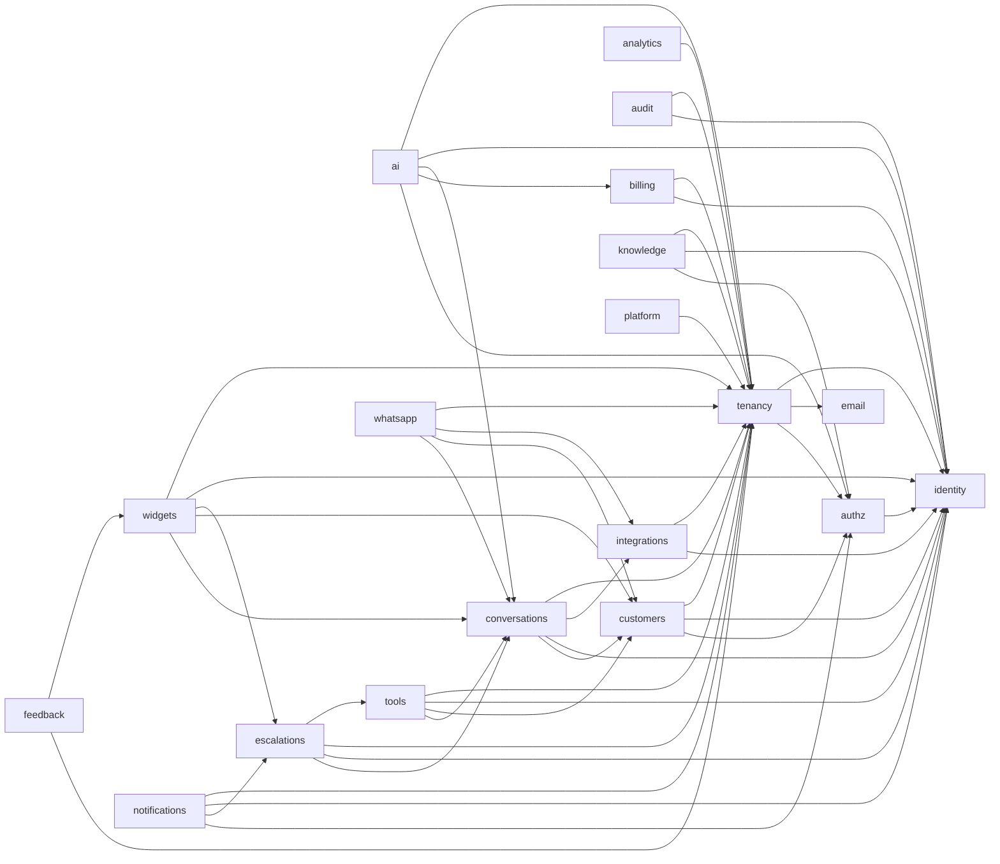

# Module dependencies

<!-- Generated by backend/tools/check-module-boundaries.mjs --write-doc from `cargo metadata` and
     backend/tools/module-boundaries.json. Do not edit by hand: CI fails when this file is stale. -->

The module crates of the backend, what each depends on, and the tables each owns. It documents
the rules of [ADR-001](../adr/0001-modular-monolith-hexagonal-modules.md) as amended by
[ADR-017](../adr/0017-module-layering-and-ci-checked-boundaries.md), as they hold in the code
today, and CI checks them (`backend/tools/check-module-boundaries.mjs`,
the `module-boundaries` step of the Backend workflow). To change a rule or accept an edge, edit
`backend/tools/module-boundaries.json` in the same PR and say why.

## Module crates

| Module | Layout | Depends on (modules) | Used by (modules) | Tables owned |
| -- | -- | -- | -- | -- |
| `ai` | flat | `authz`, `billing`, `conversations`, `identity`, `tenancy` | – | `agent_avatar_uploads`, `agent_configurations`, `agent_prompt_versions`, `agent_prompts`, `ai_configurations`, `ai_credentials`, `ai_generations`, `ai_usage_records` |
| `analytics` | flat | `tenancy` | – | – |
| `audit` | flat | `identity`, `tenancy` | – | `audit_logs` |
| `authz` | flat | `identity` | `ai`, `customers`, `knowledge`, `notifications`, `tenancy` | – |
| `billing` | flat | `identity`, `tenancy` | `ai` | `billing_plans`, `tenant_subscriptions` |
| `conversations` | flat | `customers`, `identity`, `integrations`, `tenancy` | `ai`, `escalations`, `tools`, `whatsapp`, `widgets` | `conversations`, `message_attachments`, `message_citations`, `messages` |
| `customers` | flat | `authz`, `identity`, `tenancy` | `conversations`, `tools`, `whatsapp`, `widgets` | `customer_channel_identifiers`, `customers` |
| `email` | flat | – | `tenancy` | – |
| `escalations` | flat | `conversations`, `identity`, `tenancy`, `tools` | `notifications`, `widgets` | `agent_availability`, `agent_skills`, `escalations`, `skills` |
| `feedback` | flat | `tenancy`, `widgets` | – | `conversation_feedback` |
| `identity` | flat | – | `ai`, `audit`, `authz`, `billing`, `conversations`, `customers`, `escalations`, `integrations`, `knowledge`, `notifications`, `tenancy`, `tools`, `widgets` | `mfa_factors`, `mfa_recovery_codes`, `revoked_sessions`, `users` |
| `integrations` | flat | `identity`, `tenancy` | `conversations`, `whatsapp` | `integration_catalog`, `integration_connections`, `integration_events`, `integration_secrets`, `integration_webhook_deliveries` |
| `knowledge` | flat | `authz`, `identity`, `tenancy` | – | `knowledge_categories`, `knowledge_chunks`, `knowledge_documents`, `knowledge_index_state`, `knowledge_item_tags`, `knowledge_items` |
| `notifications` | flat | `authz`, `escalations`, `identity`, `tenancy` | – | `notifications` |
| `platform` | flat | `tenancy` | – | – |
| `tenancy` | flat | `authz`, `email`, `identity` | `ai`, `analytics`, `audit`, `billing`, `conversations`, `customers`, `escalations`, `feedback`, `integrations`, `knowledge`, `notifications`, `platform`, `tools`, `whatsapp`, `widgets` | `tenant_invitations`, `tenant_memberships`, `tenant_rate_limit_overrides`, `tenants` |
| `tools` | flat | `conversations`, `customers`, `identity`, `tenancy` | `escalations` | `tenant_tool_policies`, `tenant_tools`, `tool_requests` |
| `whatsapp` | flat | `conversations`, `customers`, `integrations`, `tenancy` | – | `whatsapp_message_meta` |
| `widgets` | flat | `conversations`, `customers`, `escalations`, `identity`, `tenancy` | `feedback` | `widget_instances`, `widget_sessions` |

Shared tables, owned by no module: `outbox_events`, `secret_keks`.

## Graph

## Rules the check enforces

- A module depends on another module only through an edge listed above. A new edge fails CI until it is added on purpose; an edge that disappears must be removed from the list.
- Shared and adapter crates never depend on a module or on `server`; no module depends on `server`.
- No module calls an event consumer (`analytics`, `audit`, `notifications`); the exceptions are listed below.
- The crate graph has no cycle.
- A module that is not flat has `domain/`, `application/`, `infrastructure/` and `api/` under `src/`, and its layers import inward only. `domain/` names no framework or vendor SDK.
- Every table created by a migration has one owner. SQL that names another module's table may not grow (counts below). A read-model crate may read the tables on its list and writes nothing.

## Accepted exceptions

None.

Read models (may read other modules' tables, never write):

- `analytics` reads `ai_generations`, `ai_usage_records`, `conversation_feedback`, `conversations`, `escalations`, `messages`. Aggregates are computed over the operational tables at query time; they are read-only (analytics owns no table) until an event-built read model is worth its cost.

## Cross-module SQL still to remove

Counts of SQL references to a table another module owns, per crate. They may only go down.

| Crate | Table | Owner | References |
| -- | -- | -- | -- |
| `ai` | `conversations` | `conversations` | 1 |
| `ai` | `skills` | `escalations` | 1 |
| `billing` | `ai_usage_records` | `ai` | 1 |
| `billing` | `conversations` | `conversations` | 1 |
| `conversations` | `conversation_feedback` | `feedback` | 2 |
| `conversations` | `customers` | `customers` | 6 |
| `conversations` | `knowledge_items` | `knowledge` | 1 |
| `conversations` | `whatsapp_message_meta` | `whatsapp` | 1 |
| `conversations` | `widget_instances` | `widgets` | 2 |
| `customers` | `conversations` | `conversations` | 1 |
| `feedback` | `agent_configurations` | `ai` | 1 |
| `feedback` | `ai_generations` | `ai` | 1 |
| `feedback` | `conversations` | `conversations` | 2 |
| `notifications` | `conversations` | `conversations` | 1 |
| `server` | `ai_credentials` | `ai` | 2 |
| `server` | `audit_logs` | `audit` | 1 |
| `server` | `integration_catalog` | `integrations` | 2 |
| `server` | `integration_connections` | `integrations` | 3 |
| `server` | `integration_secrets` | `integrations` | 2 |
| `server` | `revoked_sessions` | `identity` | 1 |
| `server` | `tenant_rate_limit_overrides` | `tenancy` | 1 |
| `server` | `tenant_tools` | `tools` | 2 |
| `tenancy` | `audit_logs` | `audit` | 1 |
| `tools` | `audit_logs` | `audit` | 2 |
| `whatsapp` | `integration_connections` | `integrations` | 1 |

Total: 40.
